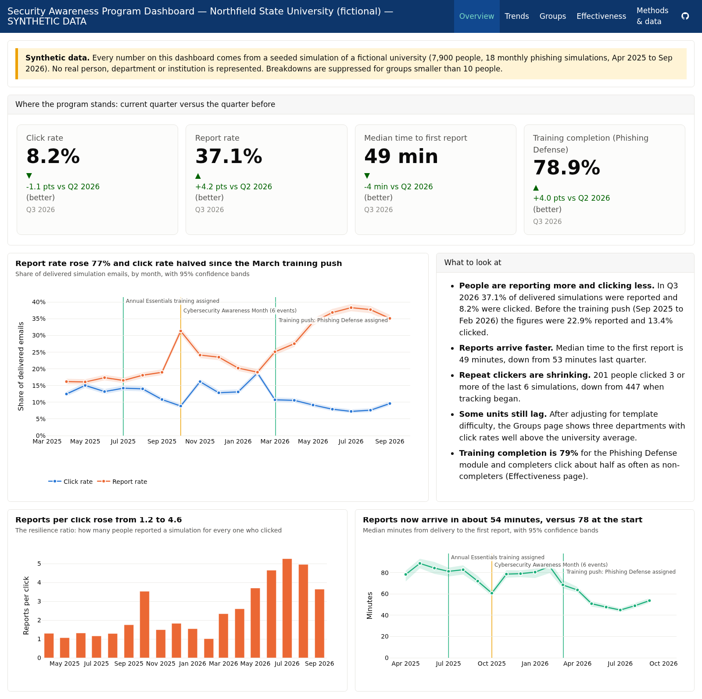

# Security Awareness Program Dashboard

**Live dashboard:** https://alferreiro.github.io/security-awareness-dashboard/

> **All data here are synthetic.** The university ("Northfield State University"), its
> departments, people, campaigns and events are fictional and were produced by a seeded
> simulation ([`scripts/generate_data.py`](scripts/generate_data.py)). No real person or
> institution is represented. The label *synthetic data* appears on every page of the dashboard.

This repository is a portfolio example of the reporting a university Office of Information
Security needs to run a security awareness program: a reproducible data pipeline, a
statistical analysis layer, and an interactive dashboard that a non-technical leadership
audience can read without help.



## What the dashboard shows

| Page | Question it answers | What is on it |
|---|---|---|
| **Overview** | Where does the program stand today? | Four headline tiles (click rate, report rate, median time to first report, training completion), each with its change versus the prior quarter; the 18-month trend; a short "what to look at" summary. |
| **Trends** | Is the program moving in the right direction, and what moved it? | Monthly click, report and credential-entry rates with 95% confidence bands; program milestones (training launches, Cybersecurity Awareness Month, newsletter special issues) drawn on the chart; newsletter engagement; event attendance; how template difficulty changed over time. |
| **Groups** | Which departments and roles need attention, compared fairly? | Department and role rates shown both raw and *adjusted for template difficulty*, so a clinical unit tested with harder lures is not blamed for being tested harder. A department-by-role heat map. Any group smaller than 10 people is hidden. |
| **Effectiveness** | Did the training push work, and is it reaching the people who matter? | Before/after comparison around the March 2026 training launch; the shrinking count of repeat clickers; a difference-in-differences test of whether completing training predicts lower click rates; training completion by department. |
| **Methods & data** | How were these numbers produced? | Plain-language description of the data, the statistics and the privacy rules, plus the campaign catalogue. |

Every chart title states the finding ("Report rate rose 77% and click rate halved since the
March training push") rather than the variable, and the titles are generated from the data,
so they stay true when the data change.

## Why report rate and time-to-report matter more than click rate alone

Click rate is the number most programs lead with, but on its own it is a weak measure of
whether an organisation is safer:

1. **Click rate depends on how hard the test was.** A 5% click rate on an obvious lure and a
   15% click rate on a convincing spear-phish can describe the same workforce. Programs that
   mature usually send harder templates over time, so a flat raw click rate can hide real
   improvement. This dashboard adjusts for template difficulty for exactly that reason.
2. **Clicks will never reach zero; reports are what stop an attack.** A real phishing campaign
   succeeds if one person clicks. It fails if someone reports it quickly enough for the
   security team to block the sender, pull the message from every inbox and reset any exposed
   credentials. The report rate measures how many people are acting as sensors for the
   organisation.
3. **Time to first report is the response window.** If the first report arrives in 10 minutes,
   the attacker has 10 minutes. The dashboard tracks the median minutes from delivery to first
   report; it fell from about 78 minutes to about 50 in the simulated data.
4. **Reports per click is the one-number summary.** When more people report than click, an
   attacker's odds flip. The Overview page shows this ratio rising from roughly 1 to roughly 4.

Click rate still belongs on the dashboard, because leadership expects it and because a rising
click rate is an early warning. It is just not the headline.

## How a team would plug in a real platform export

The pipeline reads plain CSV files from `data/`, and every analysis is a function in
[`scripts/awareness_analytics.py`](scripts/awareness_analytics.py). To use real data:

1. Export the phishing results from the platform (KnowBe4 *Phishing Security Test* results,
   Proofpoint Security Awareness, Microsoft Attack Simulation Training, and so on) and map the
   columns to `data/phishing_results.csv`:

   | Dashboard column | Typical KnowBe4 export column |
   |---|---|
   | `user_id` | Email (hash it before it reaches the dashboard) |
   | `campaign_id`, `campaign_name`, `send_date` | Campaign, Campaign Name, Start Date |
   | `template_id`, `template_difficulty` | Template, Difficulty Rating (1-5) |
   | `delivered`, `opened`, `clicked`, `data_entered`, `reported` | Delivered, Opened, Clicked, Data Entered, Reported (Yes/No -> 1/0) |
   | `minutes_to_report` | Reported At minus Delivered At, in minutes |

2. Export the people directory (`data/people.csv`: `user_id`, `department`, `role`) from the
   HR feed or the platform's user groups.
3. Export training assignments (`data/training.csv`) and, if available, newsletter and event
   data in the same shapes (see [`DATA.md`](DATA.md) for the data dictionary).
4. Update the dates of program milestones in `data/program_events.csv`.
5. Run `scripts/build.sh` (or just push to `main`; GitHub Actions renders and publishes the
   site). Nothing in the dashboard pages is hard-coded to the synthetic numbers.

The full step-by-step guide, including a monthly refresh routine, is in
[`docs/UPDATING.md`](docs/UPDATING.md).

## Privacy note

A security awareness program only works if people trust it. This dashboard is built for
**aggregate reporting, never for naming or shaming individuals**:

- No page lists a person. Repeat clickers are shown only as a monthly count.
- **Minimum group size of 10.** Any breakdown (department, role, department-by-role,
  training status) whose group has fewer than 10 people is blanked and labelled "n<10". The
  rule is applied in one function (`suppress_small_groups`) that every table passes through,
  so it cannot be bypassed by adding a new chart.
- The tidy CSV exports in `data/tidy/` follow the same rule, so a Tableau or Power BI rebuild
  inherits it.
- With real data, `user_id` should be a salted hash created before the file reaches this
  repository, and the raw export should live in an access-controlled location, not in git.

## Repository structure

```
.
├── README.md                 this file
├── DATA.md                   every assumption behind the synthetic data, and the data dictionary
├── data/                     generated CSVs (KnowBe4-style phishing results, training, newsletter, events)
│   └── tidy/                 long-format tables for Tableau Public / Power BI / Excel
├── scripts/
│   ├── generate_data.py      seeded synthetic data generator
│   ├── awareness_analytics.py  all statistics (intervals, models, adjustment, suppression)
│   ├── awareness_plots.py    Plotly figure builders with a colorblind-safe palette
│   ├── export_tidy.py        writes data/tidy/*.csv
│   └── build.sh              data -> tidy -> dashboard, end to end
├── dashboard/                Quarto dashboard (index.qmd plus one _page.qmd per page)
├── docs/
│   ├── METHODS.md            statistical methods in detail, with limitations
│   ├── INTERVIEW_GUIDE.md    how to walk through each page
│   └── UPDATING.md           how to refresh the dashboard with new or real data
├── tests/                    smoke test for the analytics layer and a screenshot script
└── .github/workflows/publish.yml   renders and deploys to GitHub Pages on every push
```

## Running it locally

```bash
pip install -r requirements.txt          # Python 3.11+
# install Quarto from https://quarto.org/docs/get-started/ (version 1.4 or later)
bash scripts/build.sh                    # regenerates data, tidy exports and dashboard/_site/index.html
```

The generator is deterministic: the same seed produces byte-identical CSVs, and the GitHub
Actions workflow checks this on every build.

## Rebuilding in Tableau Public or Power BI

`data/tidy/` holds one CSV per chart in long format (one row per month/group/metric, with
`rate`, `ci_low`, `ci_high`, `n`, `k` and a `suppressed` flag). Connect a BI tool to the folder
and every chart on the dashboard can be rebuilt without re-running any statistics. The raw
fact tables (`phishing_results.csv`, `training.csv`, `newsletter.csv`, `event_attendance.csv`)
are also tidy and can be joined to `people.csv` on `user_id`.

## Tools

Python (pandas, statsmodels, Plotly), Quarto dashboards, GitHub Actions, GitHub Pages.
Palette: a colorblind-safe categorical set (blue, orange, aqua, yellow) and a single-hue blue
ramp for magnitudes; all charts also carry direct labels, hover values and confidence
intervals so colour never carries meaning alone.

## License

MIT. The synthetic data may be reused freely; please keep the "synthetic" label.
